### A consulta certa errou em US$ 3,5 milhões

No dbt Summit 2026, conferência da dbt Labs, dois arquitetos de soluções da AWS apresentaram uma consulta de receita que devolvia US$ 14,86 milhões. A resposta certa era US$ 11,36 milhões. O número parecia plausível e vinha 30,8% maior que o real. O exemplo foi montado para a palestra, e a consulta era de um agente de IA ([dbt Labs, 2026](https://www.getdbt.com/blog/aws-dbt-semantic-layer-ai-agent-revenue-accuracy)).

O SQL fazia o que dizia fazer. As quatro regras de negócio que mudavam o número estavam escritas noutro lugar, num catálogo de definições que a consulta não usou:

- O valor somado era o bruto, anterior a desconto e reembolso;
- Os reembolsos ficavam numa tabela que não entrava no *join*;
- Pedidos cancelados e pendentes contavam como venda;
- As contas de teste eram marcadas, não excluídas.

### Quatro perguntas seguram a sopa de letrinhas

*Data warehouse*, *data lake*, *lakehouse*, *mesh*, *medallion*, ETL, ELT, dentre outros. O vocabulário de arquitetura de dados parece uma lista de marcas, e cada conceito responde, antes de tudo, a uma de quatro perguntas:

- **Onde o dado mora:** o *warehouse*, o *mart*, o *lake* e o *lakehouse*;
- **Como o dado flui:** ETL, ELT e a arquitetura *medallion*;
- **Quem cuida de cada pedaço:** o time central ou os domínios do *mesh*;
- **Como o dado se explica:** a modelagem dimensional e as rivais, do centro normalizado à tabela larga.

A resposta das três primeiras perguntas muda a cada *hype*. A quarta atravessa todas: a resposta muda de forma, e a obrigação de declarar o que o dado significa nunca sai da conta. O leitor novo que chegou para cobrá-la, o agente de IA, fecha o artigo.

### *Data warehouse*: o relatório não pode derrubar a venda

Primeira pergunta: onde o dado mora. O endereço mais antigo é o *data warehouse*. A definição clássica pede um conjunto de dados orientado por assunto, integrado, variante no tempo e não volátil, usado sobretudo para decisão ([Chaudhuri e Dayal, *An Overview of Data Warehousing and OLAP Technology*, 1997](https://www.microsoft.com/en-us/research/wp-content/uploads/2016/02/sigrecord.pdf)).

Na prática, é o banco separado da operação. O sistema que atende o cliente faz transações curtas e repetitivas, e a análise faz consultas complexas sobre o histórico consolidado. Separar os dois melhora o desempenho de ambos ([AWS](https://aws.amazon.com/what-is/data-warehouse/)). O dado entra por ETL: a limpeza acontece antes da escrita, e o esquema, o desenho de tabelas, colunas e tipos, é decidido antes de o dado chegar.

O que resolve:

- Separa a leitura analítica da escrita operacional, e as duas param de disputar recurso ([AWS](https://aws.amazon.com/what-is/data-warehouse/));
- Integra fontes diferentes num conjunto só, orientado por assunto ([Chaudhuri e Dayal, 1997](https://www.microsoft.com/en-us/research/wp-content/uploads/2016/02/sigrecord.pdf));
- Guarda o histórico que o sistema de origem descarta;
- Entrega dado limpo e estruturado, porque o esquema vem antes da escrita.

O que cobra, segundo quem propôs um sucessor, o *lakehouse* de três seções adiante:

- Na geração clássica, acoplava computação e armazenamento no mesmo equipamento, obrigando a pagar pelo pico de uso ([CIDR 2021](https://www.cidrdb.org/cidr2021/papers/cidr2021_paper17.pdf));
- Não armazenava dado não estruturado, como vídeo, áudio e texto ([CIDR 2021](https://www.cidrdb.org/cidr2021/papers/cidr2021_paper17.pdf));
- Prendia o dado no produto, o risco que esses autores chamam de *lock-in* ([CIDR 2021](https://www.cidrdb.org/cidr2021/papers/cidr2021_paper17.pdf)).

### *Data mart*: autonomia com juros

Um recorte menor do mesmo desenho é o *data mart*: um conjunto com o dado já processado para as perguntas de uma unidade de negócio, como vendas ou financeiro ([AWS](https://aws.amazon.com/what-is/data-mart/)). O *mart* pode derivar do *data warehouse* central, nascer independente ou misturar as duas origens.

Para Bill Inmon, o *warehouse* corporativo vem primeiro, e a fonte correta do *mart* é ele, e somente ele ([Inmon, *A Tale of Two Architectures*](https://williaminmon.substack.com/p/a-tale-of-two-architectures-kimball)). 

Já Ralph Kimball, o sistematizador da modelagem dimensional que a quarta pergunta vai visitar, aponta o caminho inverso: o *warehouse* se constrói *mart* a *mart*, um por processo de negócio, integrados por dimensões compartilhadas ([Margy Ross, do grupo de Kimball, 2004](https://decisionworks.com/2004/03/differences-of-opinion/)). 

Nenhum lado venceu: segundo um artigo do TDWI, a maioria das implementações grandes acabou híbrida ([TDWI, 2026](https://tdwi.org/blogs/data-101/2026/05/architectural-disagreement-that-still-shapes-data-warehouses.aspx)).

O que resolve:

- Dá à área autonomia sobre a própria carga e gestão, sem fila do time central ([AWS](https://aws.amazon.com/what-is/data-mart/));
- Permite controle de acesso fino, porque só o dado daquele assunto está ali;
- No tipo híbrido, serve para testar uma origem nova antes de levá-la ao centro ([AWS](https://aws.amazon.com/what-is/data-mart/)).

O que cobra:

- O *mart* dependente herda a indisponibilidade do *warehouse* de origem ([AWS](https://aws.amazon.com/what-is/data-mart/));
- *Marts* independentes multiplicam processos de carga, e dois processos respondendo à mesma pergunta tendem a terminar em dois números.

### *Data lake*: guarde agora, explique depois

O terceiro endereço nasceu na direção oposta. O *data lake* é um repositório que guarda qualquer dado, estruturado ou não, no formato em que chega e em qualquer escala ([AWS](https://aws.amazon.com/what-is/data-lake/)). A inversão está na ordem entre esquema e escrita. O *warehouse* exige estrutura antes de gravar; o *lake* grava primeiro e cobra o esquema de quem lê. Por dentro, o dado não fica indistinto: a prática recomendada é segmentar em zonas conforme a prontidão, do pouso do arquivo cru ao conjunto curado ([AWS Well-Architected](https://docs.aws.amazon.com/wellarchitected/latest/analytics-lens/configuration-notes.html)).

O que resolve:

- Aceita o que o *warehouse* recusava: relacional e não relacional, de log de aplicação a mídia ([AWS](https://aws.amazon.com/what-is/data-lake/));
- Armazenamento de objeto barato, em qualquer escala ([AWS](https://aws.amazon.com/what-is/data-lake/));
- A pergunta pode aparecer depois do dado, porque o esquema só é cobrado na leitura;
- Sustenta aprendizado de máquina sobre o histórico bruto.

O que cobra:

- Sem catálogo que registre o que existe, vira um *data swamp*, o pântano onde nada é encontrado nem merece confiança, aviso do guia de arquitetura de quem o vende ([AWS Well-Architected](https://docs.aws.amazon.com/wellarchitected/latest/analytics-lens/configuration-notes.html));
- O custo do esquema muda de lugar, e cada leitor paga um pouco dele;
- Consistência entre leitores depende de disciplina, porque cada um interpreta o cru por conta própria.

A linha do tempo guarda uma confissão. O *lake* foi a década que adiou a modelagem, o pântano foi o preço, e ela voltou porque fez falta.

### *Data lakehouse*: a aposta de uma cópia só

O quarto endereço tenta parar de escolher. Em 2021, engenheiros ligados à Databricks definiram o *data lakehouse* como um sistema de gestão de dados sobre armazenamento barato e de acesso direto, com funções de banco analítico por cima: transação, versionamento, auditoria e otimização de consulta ([Armbrust, Ghodsi, Xin e Zaharia, CIDR 2021](https://www.cidrdb.org/cidr2021/papers/cidr2021_paper17.pdf)). No desenho de referência do artigo, quem sustenta as garantias é uma camada de metadados, os dados sobre os dados, que diz quais arquivos formam cada versão de cada tabela. O mesmo texto conta a história em gerações. Primeiro o *data warehouse*, com esquema na escrita. Depois o *lake*, numa arquitetura de duas camadas, com o bruto no armazenamento barato e um recorte seguindo por ETL para o *warehouse*, envelhecendo no caminho. A aposta do *lakehouse* é servir, da mesma cópia do dado, o BI, os relatórios e painéis do negócio, e o treino de modelos de aprendizado de máquina.

O que resolve:

- Uma cópia do dado para o relatório e para o treino de modelos, sem exportar para um segundo sistema ([Databricks](https://docs.databricks.com/aws/en/lakehouse/));
- Transação, imposição de esquema e governança sobre o que antes era só arquivo ([Databricks](https://docs.databricks.com/aws/en/lakehouse/));
- Formato aberto, que deixa o dado legível sem passar pelo produto que o escreveu ([Databricks](https://docs.databricks.com/aws/en/lakehouse/));
- Na defesa dos autores, dispensa o ETL duplo e o dado defasado da arquitetura de duas camadas ([CIDR 2021](https://www.cidrdb.org/cidr2021/papers/cidr2021_paper17.pdf)).

O que cobra:

- A medição de desempenho que acompanha a proposta é dos próprios autores, interessados nela ([CIDR 2021](https://www.cidrdb.org/cidr2021/papers/cidr2021_paper17.pdf));
- Cada fornecedor implementa a ideia com o próprio formato e o próprio catálogo, e é dentro deles que a promessa foi demonstrada;
- O desenho é novo o bastante para a própria definição ainda variar conforme quem a escreve.

### De ETL a ELT: o custo trocou as letras de lugar

A segunda pergunta é como o dado flui da origem até o destino analítico. A resposta clássica é o ETL: extrair, transformar e carregar, nesta ordem. O dado sai do sistema de origem. A regra de limpeza e de negócio roda em trânsito. Só o resultado limpo é gravado no destino. Essa ordem existia por escassez: o destino era caro e rígido, e transformar antes de carregar reduzia o que chegava a ele ([dbt Labs](https://www.getdbt.com/blog/data-movement-patterns)).

O ELT inverte as duas últimas etapas: extrair, carregar o bruto direto no destino e transformar lá dentro, com o motor do próprio destino, a capacidade de processamento que ele traz junto do armazenamento ([AWS](https://aws.amazon.com/what-is/etl/)). A virada é datada pela IBM por volta de 2010. A IBM, que vende o armazenamento e o processamento que tornam o arranjo viável, credita a mudança ao aumento do volume de dado e à chegada da computação em nuvem, que trouxe armazenamento barato e escalável e capacidade de transformar em escala no próprio destino ([IBM](https://www.ibm.com/think/topics/elt)). Quando guardar deixou de ser o gargalo, adiar a transformação virou vantagem. O padrão pressupõe um destino com motor próprio, caso do *warehouse* de nuvem e do *lakehouse*.

O que resolve:

- Entrega mais rápida ([IBM](https://www.ibm.com/think/topics/elt)): a carga deixa de esperar a regra ficar pronta;
- O bruto fica disponível para vários usos, inclusive o que ninguém previu na hora da carga ([IBM](https://www.ibm.com/think/topics/elt));
- A lógica pode ser refeita sem voltar à origem, iterando sobre o que já está carregado, ponto de quem vende ferramenta para esse arranjo ([dbt Labs](https://www.getdbt.com/blog/why-etl-matters-data-pipelines)).

O que cobra:

- A despesa de armazenamento e de processamento pode escalar de forma imprevisível ([IBM](https://www.ibm.com/think/topics/elt)): é o preço de manter o bruto em cópia no destino;
- A segurança do dado não processado entra na conta ([IBM](https://www.ibm.com/think/topics/elt)): o sensível chega cru, e a proteção que o ETL aplicava antes da escrita passa a depender do destino;
- Dado regulado pede a ordem antiga na frente: mascarar o identificador sensível por ETL antes da carga e refinar por ELT depois, um híbrido com duas esteiras na conta, concessão de quem vende o lado do ELT ([dbt Labs](https://www.getdbt.com/blog/why-etl-matters-data-pipelines)).

O saldo, na minha leitura, é que a praticidade venceu, e a conta ficou no destino: a cópia do bruto e cada transformação rodando no motor dele. Carregar o dado bruto e refinar depois também deixa estados diferentes do dado convivendo no mesmo lugar, e o *medallion*, logo abaixo, dá um lugar a cada estado.

### *Medallion*: o preço de guardar o bruto e servir o limpo

Ainda na pergunta do fluxo, a arquitetura *medallion* organiza o *lakehouse* em três camadas por estado de prontidão ([Databricks](https://docs.databricks.com/aws/en/lakehouse/medallion)):

- A camada *bronze* guarda o dado exatamente como chegou da origem, e é a fonte para reconstruir o resto;
- A camada *silver* guarda o dado validado, limpo e deduplicado;
- A camada *gold* guarda o dado agregado e modelado para o consumo.

Gosto do *medallion* porque ele admite um conflito em vez de fingir que não existe: preservar o bruto para auditar e entregar o limpo para confiar são desejos opostos, e o padrão dá um endereço a cada um. E ele devolve a modelagem ao palco: a própria documentação diz que a camada *gold* é modelada segundo a regra de negócio, inclusive com modelagem dimensional ([Databricks](https://docs.databricks.com/aws/en/lakehouse/medallion)).

O que resolve:

- Um lugar previsível para cada estado do dado, com público por camada ([Databricks](https://docs.databricks.com/aws/en/lakehouse/medallion));
- Reprocessar o histórico quando uma regra muda, porque o *bronze* é a fonte da verdade;
- Controle de acesso e otimização diferentes por camada.

O que cobra:

- É prática recomendada e adaptável, não requisito, e o custo de cada camada a mais fica com quem opera ([Databricks](https://docs.databricks.com/aws/en/lakehouse/medallion));
- Cada camada acrescenta uma cópia e um salto de latência entre a origem e o consumo.

### *Data mesh*: a fila do time central

O *data mesh* responde à terceira pergunta: quem cuida de cada pedaço do dado. Zhamak Dehghani o propôs ao criticar o *lake* monolítico, em que um time central de dados, dono de tudo e distante do negócio, vira fila conforme crescem as fontes e os consumidores. Os princípios dela, consolidados em 2020, são quatro ([Dehghani, *Data Mesh Principles and Logical Architecture*, martinfowler.com, 2020](https://martinfowler.com/articles/data-mesh-principles.html)):

- **Propriedade por domínio:** o time de negócio mais próximo do dado é dono dele, e o ecossistema cresce adicionando domínios autônomos;
- **Dado como produto:** cada domínio publica seus dados para serem encontrados, entendidos e confiados por quem consome;
- **Plataforma *self-service*:** uma infraestrutura comum esconde a complexidade técnica para os domínios trabalharem sozinhos;
- **Governança federada:** decisões locais dentro de regras globais de interoperabilidade, aplicadas de forma automatizada.

O sintoma que o motiva tem registro público com número. A Uber relatou um *warehouse* com mais de 16.000 *datasets* e 10 petabytes, vindos de vários domínios de negócio e operados por um único time: pico de consumo ou corrupção de metadados de um time derrubava cargas alheias, e a maioria dos times e serviços tinha acesso de leitura e escrita mais largo do que precisava. Mudança de acesso e resposta a incidente passavam pelo time central. A saída foi fatiar o banco por domínio, com acesso estrito em cada fatia ([Uber Engineering, 2026](https://www.uber.com/br/en/blog/database-federation/)). O relato não usa a palavra *mesh*, e leio o caso como um pedaço do diagnóstico aparecendo na prática: concentrar tudo num dono único não escalou, e o corte foi por domínio.

O que resolve:

- Tira o time central do caminho crítico de cada pedido ([Dehghani, 2020](https://martinfowler.com/articles/data-mesh-principles.html));
- Escala por adição de domínios autônomos, em vez de inflar um gargalo;
- Aproxima o dono do dado de quem entende o negócio que o gera.

O que cobra:

- Gestão de mudança, gente qualificada em cada domínio e duplicação de dados e de esforço, segundo uma revisão sistemática de literatura cinzenta, feita sobre relatos de prática ([Goedegebuure e colegas, arXiv](https://arxiv.org/abs/2304.01062));
- A governança federada devolve aos domínios, como negociação permanente, a coordenação que o centro pagava sozinho, leitura minha dos próprios princípios;
- A recepção ainda polariza, de manchete dando o *mesh* por morto a quem diz que é cedo para enterrá-lo ([Analytics India Magazine](https://analyticsindiamag.com/data-mesh-is-dead-it-just-doesnt-know-it)).

### Modelagem dimensional: o desenho que ninguém aposentou

Respondidas as três primeiras perguntas, sobra a que a IA vai cobrar: como o dado se explica. Esta seção e as três seguintes percorrem as respostas, da estrela desnormalizada ao centro normalizado, e de volta à tabela achatada que dispensa junção. A resposta mais duradoura é a modelagem dimensional, que Ralph Kimball sistematizou em 1996 no livro *The Data Warehouse Toolkit* ([Kimball Group](https://www.kimballgroup.com/data-warehouse-business-intelligence-resources/kimball-techniques/dimensional-modeling-techniques/)). A ideia separa as tabelas em dois papéis:

- A tabela fato guarda a medição de um evento do negócio, como o valor de uma venda;
- A tabela dimensão guarda o contexto que dá sentido à medida: quem comprou, o quê, onde, quando.

No desenho relacional, a tabela fato fica no centro e as dimensões em volta, cada uma em tabela única e desnormalizada: os atributos ficam juntos, repetindo valores quando preciso, para a consulta não atravessar tabelas. Kimball descrevia a estrutura como uma junção em estrela, o *star join*; *star schema* é o nome corrente ([Kimball, *A Dimensional Modeling Manifesto*, 1997](https://www.kimballgroup.com/1997/08/a-dimensional-modeling-manifesto/)).

O método tem quatro passos, nesta ordem: escolher o processo de negócio, declarar o grão, identificar as dimensões e identificar os fatos ([Kimball Group](https://www.kimballgroup.com/data-warehouse-business-intelligence-resources/kimball-techniques/dimensional-modeling-techniques/four-4-step-design-process/)). O grão vem antes de qualquer coluna porque diz o que uma linha da tabela fato significa. Numa fato de vendas com grão de um item por pedido, cada linha é um item vendido, e a pergunta sobre qual produto saiu mais tem resposta direta. Se o grão fosse o pedido inteiro, a mesma tabela não saberia responder.

Quando os processos se multiplicam, as estrelas se ligam pelas dimensões compartilhadas: a mesma dimensão de cliente servindo à fato de vendas e à de entregas é o que permite cruzar as duas. Um desenho assim, com várias fatos e dimensões em comum, também circula com nome próprio, *galaxy schema*, com definições que variam conforme o autor ([Wikipedia](https://en.wikipedia.org/wiki/Galaxy_schema)).

O que resolve:

- Estrutura que o usuário final entende e navega, com consultas de comportamento previsível, defesa do próprio Kimball ([Kimball, 1997](https://www.kimballgroup.com/1997/08/a-dimensional-modeling-manifesto/));
- Integração entre processos pelas dimensões compartilhadas;
- O grão declarado vira contrato: toda linha significa a mesma coisa.

O que cobra:

- Manter a integridade ao carregar de sistemas diferentes é difícil, e o desenho fica rígido quando o processo de negócio muda ([Wikipedia](https://en.wikipedia.org/wiki/Dimensional_modeling));
- A técnica nasceu da observação da prática, sem base teórica nem teste empírico, avaliação de Moody e Kortink em 2000 ([Moody e Kortink](https://ceur-ws.org/Vol-28/paper5.pdf));
- Declarar grão e dimensões antes de conhecer todas as perguntas é trabalho antecipado, que times em descoberta adiam.

### *Snowflake schema*: a ordem que custa junções

O *snowflake schema* é a variação que normaliza, ou seja, elimina a repetição quebrando a dimensão em tabelas menores: produto, subcategoria e categoria, separados e ligados por chaves. A hierarquia fica explícita no desenho, e a repetição sai das tabelas normalizadas. Em troca vêm mais tabelas e mais *joins* por consulta, com desempenho tipicamente pior ([Oracle](https://docs.oracle.com/cd/A97630_01/server.920/a96520/schemas.htm)). O próprio Kimball escreveu em 1997 que o *snowflaking* não contraria a modelagem dimensional quando melhora compreensão e desempenho, e avaliou, no mesmo texto, que costuma prejudicar a navegação e a legibilidade ([Kimball, 1997](https://www.kimballgroup.com/1997/08/a-dimensional-modeling-manifesto/)). No consumo, a recomendação da Microsoft segue a mesma direção: em geral os benefícios da dimensão em tabela única superam os da normalizada ([Microsoft Learn](https://learn.microsoft.com/en-us/power-bi/guidance/star-schema)).

### 3FN e Inmon: primeiro o centro, depois os *marts*

Do outro lado da disputa fica a escola que normaliza o centro. Na abordagem de Bill Inmon, constrói-se primeiro um *warehouse* corporativo único, integrado e granular, em modelo relacional normalizado, e dele derivam os *marts* ([Inmon, *A Tale of Two Architectures*](https://williaminmon.substack.com/p/a-tale-of-two-architectures-kimball)). Terceiros resumem essa forma como terceira forma normal (3FN), o desenho clássico em que cada atributo depende só da chave, a coluna que identifica a linha; o próprio Inmon a descreve como normalizada com leve desnormalização, com os *marts* de consumo em estrela, no estilo de Kimball ([Inmon](https://williaminmon.substack.com/p/a-tale-of-two-architectures-kimball)). Como a seção do *mart* registrou, a prática acomodou as duas escolas.

O que resolve:

- Uma versão única e integrada da verdade corporativa, antes de servir cada departamento ([Inmon](https://williaminmon.substack.com/p/a-tale-of-two-architectures-kimball));
- Histórico granular e governança centralizados;
- O centro normalizado evita a redundância que a estrela aceita.

O que cobra:

- Valor que chega tarde, porque a integração vem antes do primeiro relatório, avaliação de um artigo do TDWI ([TDWI, 2026](https://tdwi.org/blogs/data-101/2026/05/architectural-disagreement-that-still-shapes-data-warehouses.aspx));
- Normalizar no centro e dimensionalizar no consumo duplica ETL e armazenamento, crítica do lado Kimball ([Ross, 2004](https://decisionworks.com/2004/03/differences-of-opinion/));
- Integração é a parte mais difícil, e o próprio Inmon a trata como esforço de longo prazo ([Inmon](https://williaminmon.substack.com/p/a-tale-of-two-architectures-kimball)).

### *One Big Table*: disco é barato, engenheiro não

A *One Big Table* (OBT) é a tabela única, larga e desnormalizada, com fato e dimensões já juntados de antemão, consultada sem *join*. Um registro cedo do debate é um fórum de engenharia analítica perguntando, em 2019, se a modelagem de Kimball ainda era relevante num *warehouse* moderno ([fórum da dbt](https://discourse.getdbt.com/t/is-kimball-dimensional-modeling-still-relevant-in-a-modern-data-warehouse/225)). O argumento econômico registrado ali: com o *warehouse* na nuvem e o armazenamento em colunas, guardar valor repetido ficou barato, e o tempo de engenheiro, caro.

O que resolve:

- Consulta sem junções, mais rápida num teste publicado por uma fornecedora de *pipelines*: de 25% a 49% conforme o *warehouse*, com resultado misto num deles ([Kaminsky, Fivetran, 2022](https://www.fivetran.com/blog/star-schema-vs-obt));
- Tabela plana que o usuário de negócio lê sem mapa.

O que cobra:

- No pior caso do mesmo teste, sem compressão de coluna ajustada, o disco foi de pouco mais de 30 GB com a estrela para mais de 90 GB com a tabela larga ([Kaminsky, Fivetran, 2022](https://www.fivetran.com/blog/star-schema-vs-obt));
- O significado se dilui na tabela gigante, e achar a coluna certa vira o novo problema, queixa registrada no fórum do debate ([fórum da dbt](https://discourse.getdbt.com/t/is-kimball-dimensional-modeling-still-relevant-in-a-modern-data-warehouse/225));
- Cada pergunta nova tende a gerar outra tabela larga, e a mesma lógica passa a viver em várias.

O detalhe que me interessa está no fecho do próprio teste: o autor sugere manter a estrela nas etapas de transformação e gravar a tabela larga pronta por cima, para o usuário final consultar sem junções ([Kaminsky, Fivetran, 2022](https://www.fivetran.com/blog/star-schema-vs-obt)). A estrela continua no desenho, uma camada abaixo de quem consulta.

### O agente não pergunta o que a tabela quer dizer

Até aqui, o leitor final do dado era uma pessoa, com um analista por perto para desfazer ambiguidade. A novidade é o agente como leitor. E o agente não é um analista mais rápido, é um leitor sem o contexto tácito que o analista carrega. Dustin Dorsey, diretor de engenharia de dados numa consultoria parceira da dbt Labs, argumenta, sem medição, que a prova de conceito com IA funciona porque roda num perímetro onde anos de uso humano já impuseram o significado. Em produção o perímetro some. A mesma pergunta passa a ter várias respostas tecnicamente válidas, o modelo escolhe uma delas, e a inconsistência que sai é defensável, difícil de perceber. A década que centralizou onde o dado vive deixou de fora o que ele representa ([Dorsey, blog da dbt Labs, 2026](https://www.getdbt.com/blog/your-ai-isn-t-broken-your-data-model-is)).

Há um número para o tamanho do problema, relatado na mesma palestra da AWS que abre este artigo: num *benchmark* de consultas reais de *warehouse* corporativo, coautorado por pesquisadores da AWS, agentes de ponta acertaram 10,8% ([dbt Labs, 2026](https://www.getdbt.com/blog/aws-dbt-semantic-layer-ai-agent-revenue-accuracy)).

A resposta que o mercado testa é a *semantic layer*, a camada semântica: declarar métrica, dimensão e relação entre tabelas uma única vez, fora da ferramenta de consumo, e deixar pessoas e agentes consultarem a definição em vez de reescrevê-la a cada consulta ([documentação do dbt](https://docs.getdbt.com/docs/use-dbt-semantic-layer/dbt-sl)). O dbt é uma ferramenta de transformação de dados, e a fabricante dele vende uma implementação da camada: os números de efeito vêm de quem tem interesse neles, e ainda assim desenham uma direção. Num *benchmark* interno da dbt Labs, sem método divulgado, um analista de IA ancorado na *semantic layer* acertou de 96% a 100% das perguntas, contra 80% a 91% escrevendo SQL cru ([dbt Labs, 2026](https://www.getdbt.com/blog/semantic-layer-ai-analyst-accuracy)).

Numa consultoria que mediu um agente de *analytics* contra perguntas de gabarito, específicas a ponto de dois analistas escreverem o mesmo SQL, **a acurácia foi de 0% sem contexto semântico a 94,7% com as camadas de contexto somadas**, das tabelas modeladas às métricas nomeadas e consultas verificadas, sem trocar de modelo ([Data Culture, blog da dbt Labs, 2026](https://www.getdbt.com/blog/data-culture-ai-analytics-agent-trust-context)). Nenhum desses números isola a modelagem: eles medem contexto empilhado, das tabelas modeladas às consultas prontas.

O catálogo de definições da abertura era exatamente isso, uma *semantic layer*: as quatro regras dos US$ 3,5 milhões moravam nela, declaradas e ignoradas pela consulta. A camada, porém, precisa de matéria-prima. O grão declarado e a relação explícita vêm da modelagem, e é sobre eles que a métrica ganha definição única e dona. É o argumento de Dorsey para tratar fatos e dimensões como o mecanismo que torna o significado legível para a IA ([Dorsey, 2026](https://www.getdbt.com/blog/your-ai-isn-t-broken-your-data-model-is)). A exigência que o BI tolerava por décadas, porque havia gente para compensar, virou, na minha leitura, pré-requisito.

### Arquitetura tem que ter propósito

Onde o dado mora, como ele flui e quem cuida dele são decisões de plataforma e de organização, e as duas passam. Como o dado se explica é decisão de modelagem, e essa nenhuma geração conseguiu aposentar. A estrela segue viva, da camada de transformação à *gold* do *medallion*. A tabela larga serve o consumo sem junção. E do centro normalizado de Inmon à tabela, toda resposta depende de entidade, relação e definição declarados para continuar dizendo a mesma coisa. O que fica da modelagem é o que ela obriga a declarar.
